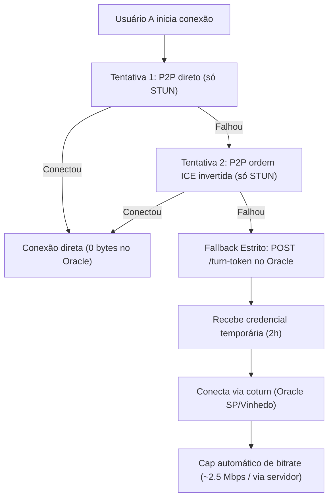

# Plano de Implementação — Telinha Café + Oracle Cloud Always Free (TURN + Sinalização)

> **Status:** Planejado (implementar em etapa futura)
> **Objetivo:** Eliminar ~95–99% dos erros de conexão (CGNAT / roteadores rígidos / 4G-5G) dos usuários do Telinha Café mantendo **custo R$ 0/mês**, **zero risco de fatura surpresa** e **uso estrito do TURN apenas quando o P2P direto falhar**.

---

## 1. Arquitetura Alvo

### Garantias de custo e privacidade
- **P2P primeiro sempre:** quem consegue conexão direta **nunca** chama `/turn-token` e gasta **0 bytes** do servidor.
- **Credenciais temporárias (HMAC-SHA1):** o segredo do `coturn` fica só no servidor; o app recebe credenciais válidas por 2 horas com *rate limit* por IP.
- **Cap no relay:** quando uma conexão cai em `"via servidor"`, o bitrate máximo é reduzido automaticamente (~2,5 Mbps) para que os **10 TB/mês** grátis da Oracle aguentem **~1.000+ usuários ativos**.

---

## 2. Infraestrutura na Oracle Cloud (Always Free)

### Especificação da VM (R$ 0/mês)
- **Região:** `sa-saopaulo-1` (São Paulo) ou `sa-vinhedo-1` (Vinhedo — geralmente com mais disponibilidade de capacidade ARM).
- **Shape:** `VM.Standard.A1.Flex` (ARM64) — até **4 OCPU**, **24 GB RAM**, **200 GB Boot Volume**, **10 TB/mês** de tráfego de saída inclusos no Always Free.
- **SO:** Ubuntu 24.04 LTS (ARM64).
- **Domínio (opcional, recomendado):** subdomínio apontando pro IP público fixo da VM (ex.: `rtc.fatecafe.com.br`), necessário para HTTPS/WSS e TURNS (porta 5349).

### Portas a liberar (Oracle VCN Security List + Firewall Ubuntu)
| Porta | Protocolo | Uso |
| :--- | :--- | :--- |
| `22` | TCP | SSH (administração) |
| `80` / `443` | TCP | Caddy (HTTPS automático + WSS PeerJS + `/turn-token`) |
| `3478` | TCP + UDP | STUN / TURN (`coturn`) |
| `5349` | TCP + UDP | TURNS (TLS — atravessa firewalls corporativos/4G restritos) |
| `49152–50152` | UDP | Portas de relay de mídia do `coturn` (1.000 portas é mais que suficiente e fácil de manter) |

---

## 3. Stack Docker na VM (pasta `server/` a criar)

Quando formos implementar, criaremos `server/` no repositório com:
1. **`docker-compose.yml`** subindo 4 containers leves (~250 MB RAM no total):
   - **`caddy`**: proxy reverso com certificado SSL Let's Encrypt automático.
     - `wss://rtc.seudominio.com/peerjs` → `peerjs-server:9000`
     - `https://rtc.seudominio.com/turn-token` → `turn-auth:3000`
   - **`peerjs-server`**: servidor de sinalização próprio (`peerjs/peerjs-server`) 24/7, sem depender do `0.peerjs.com`.
   - **`coturn`**: servidor TURN/TURNS configurado com:
     - `use-auth-secret` + `static-auth-secret` (via `.env`)
     - `min-port=49152`, `max-port=50152`
     - `max-bps=3500000` (teto de segurança por sessão no relay)
     - `no-multicast-peers`, `no-loopback-peers` (proteção contra SSRF)
   - **`turn-auth`**: micro-serviço Node.js (~40 linhas) que gera credenciais temporárias (`username = expiry:id`, `credential = HMAC-SHA1`) com *rate limit* por IP (ex.: máx. 15 tokens/hora por IP).
2. **`server/.env.example`**: variáveis (`DOMAIN`, `TURN_SECRET`, `EXTERNAL_IP`).
3. **`server/install.sh`**: script de setup rápido pra Ubuntu (instala Docker, libera `iptables`/UFW e sobe a stack).

---

## 4. Mudanças Planejadas no App (`Telinha Café`)

### A. `src/renderer/lib/net.js`
- Adicionar `fetchTurnToken(endpointUrl)` com timeout curto (4s), cache em memória enquanto o token for válido e validação estrita da resposta (`urls`, `username`, `credential`).
- Adicionar `DEFAULT_TURN_ENDPOINT` (apontando para `https://rtc.seudominio.com/turn-token`) e `DEFAULT_SIGNAL_SERVER` (com fallback automático para `0.peerjs.com` se o servidor próprio não responder em 5s).

### B. `src/renderer/app.js`
- **Fallback Estrito de TURN (`doorJoinChecked`, `connectTo`, `callPeer`):**
  1. Tentativa 1: `iceServers` **apenas STUN**, ordem padrão (`firstGuess`).
  2. Tentativa 2: `iceServers` **apenas STUN**, ordem invertida (`flipFirst`).
  3. Tentativa 3 (**somente se 1 e 2 falharem**): chama `fetchTurnToken()`, adiciona o TURN retornado e reconecta com `iceTransportPolicy: 'all'` (ou `'relay'`), marcando `p.needsTurn = true` para a sessão atual.
- **Cap automático de bitrate no relay:** em `applySenderParams(pc, kind)`, se `p.relay === true` e `kind === 'screen'`, limitar `maxBitrate` em `2500 kbps` e `maxFramerate` em `30 fps` (evitando estourar banda no servidor quando alguém estiver em `1080p60`/`max60`).
- **Configurações → Avançado:**
  - Campo opcional para customizar/desativar o endpoint de TURN dinâmico.
  - Exibir no botão *"Testar minha rede"* se o servidor comunitário (Oracle) está online e qual o ping até ele.

### C. Testes (`test/telinha.test.js`)
- Testar `fetchTurnToken` (cache, expiração, fallback em erro/timeout).
- Testar que tentativas 1 e 2 nunca incluem TURN quando está em modo Fallback Estrito.
- Testar cap de bitrate quando `p.relay === true`.

---

## 5. Checklist de Execução (quando formos fazer)

- [ ] Criar conta na Oracle Cloud e provisionar VM ARM (`sa-saopaulo-1` ou `sa-vinhedo-1`)
- [ ] Apontar subdomínio (ex.: `rtc.fatecafe.com.br`) para o IP público da VM
- [ ] Abrir portas na VCN Security List da Oracle (`80, 443, 3478, 5349, 49152-50152`)
- [ ] Criar pasta `server/` no repositório (`docker-compose.yml`, `Caddyfile`, `turnserver.conf`, `turn-auth`, `install.sh`)
- [ ] Subir stack na VM e validar com *Trickle ICE* + diagnóstico do Telinha Café
- [ ] Implementar Fallback Estrito de TURN + cap de bitrate no relay + sinalização com fallback no app
- [ ] Rodar `npm test` + teste real entre 2 redes (ex.: PC na fibra + celular no 4G/5G)
- [ ] Atualizar `README.md` e lançar nova versão
